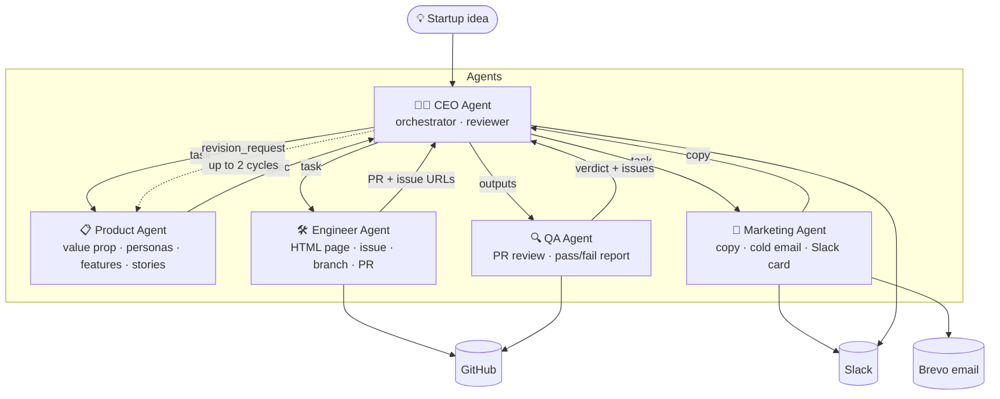

<div align="center">

# 🚀 LaunchMind

### Type a startup idea. Five AI agents ship it.

**A multi-agent system that turns one sentence into a product spec, a landing page, a GitHub pull request, a launch email and a Slack announcement, and reviews its own work before it goes out.**


</div>

---

## ✨ What it does (condensed example run)

```text
$ python main.py
Enter your startup idea: A women-only ride-sharing app with vetted drivers and SOS

[CEO]      Decomposing idea into tasks...
[PRODUCT]  Spec drafted: personas, features, user stories
[CEO]      Reviewing spec... revision requested (1/2)
[ENGINEER] Landing page generated · issue opened · branch pushed · PR opened
[MARKETING]Tagline + cold email sent · Slack launch card posted
[QA]       Reviewed PR and copy · inline comments posted · verdict: PASS
[CEO]      Final summary posted to #launches ✅
```

No hard-coded idea and no scripted steps. The CEO agent asks an LLM to break whatever you type into tasks, hands them to specialist agents, and sends work back when it isn't good enough.

---

## 🧠 Architecture



### How the agents talk
Every message is a small JSON object on a shared in-memory **message bus** (`message_bus.py`) with a sender, receiver, type (`task`, `result`, `revision_request`, `confirmation`), timestamp, id and `parent_message_id`. That makes each run a fully traceable conversation, so you can replay who asked whom for what.

| Step | From → To | What happens |
|---|---|---|
| 1 | CEO → Product | Decompose the idea into a product spec |
| 2 | Product → CEO | Spec comes back as structured JSON |
| 3 | CEO ⇄ Product | CEO critiques the spec with an LLM and requests revisions, at most 2 cycles |
| 4 | CEO → Engineer | Build the landing page and open the GitHub PR |
| 5 | CEO → Marketing | Write copy, send the email, post to Slack |
| 6 | CEO → QA | Review the PR and the copy |
| 7 | QA → CEO | Pass/fail report plus inline PR comments |
| 8 | CEO | Posts the final summary to Slack |

---

## 🔌 Real integrations, not mocks

| Platform | What the agents actually do |
|---|---|
| **GitHub** | Create a branch, commit a full `index.html`, open an LLM-written issue, open a pull request, all via the REST API. The QA agent then comments on the PR |
| **Slack** | Marketing posts a Block Kit launch card (tagline, description, PR link, status). The CEO posts the final summary |
| **Brevo** | Sends a cold-outreach email with an LLM-written subject and body |
| **Gemini** | Reasoning for every agent: decomposition, specs, HTML, PR text, copy, QA review |
| **Hugging Face** | Automatic fallback to Llama-3.3-70B when the Gemini quota runs out |

---

## ⚡ Quick start

**Prerequisites:** Python 3.11+, a GitHub repo and token, a Slack app with a bot token, a Brevo account (free tier is enough) and a Gemini API key.

```bash
git clone https://github.com/afanatif/launchmind-multi-agent-startup.git
cd launchmind-multi-agent-startup
pip install -r requirements.txt
cp .env.example .env      # then fill in your keys
python main.py
```

<details>
<summary><b>🔑 Environment variables</b></summary>

| Variable | Where to get it |
|---|---|
| `GEMINI_API_KEY` | [aistudio.google.com](https://aistudio.google.com) → Get API key |
| `HF_API_KEY` | [huggingface.co/settings/tokens](https://huggingface.co/settings/tokens) |
| `GITHUB_TOKEN` | GitHub → Settings → Developer settings → Personal access tokens (`repo` scope) |
| `GITHUB_REPO` | `your-username/your-repo-name` (the repo the agents will open PRs in) |
| `SLACK_BOT_TOKEN` | Slack app → OAuth & Permissions → Bot User OAuth Token (`xoxb-…`) |
| `BREVO_API_KEY` | Brevo → Settings → API keys |
| `BREVO_FROM_EMAIL` | A verified sender in your Brevo account |
| `TEST_EMAIL` | An inbox you control; cold outreach goes here |

</details>

<details>
<summary><b>💬 Slack setup</b></summary>

1. [api.slack.com/apps](https://api.slack.com/apps) → your app → **OAuth & Permissions**
2. Add bot scopes: `chat:write`, `chat:write.public`, `channels:read`, `groups:read`
3. **Reinstall to Workspace**
4. Create a `#launches` channel and run `/invite @YourBotName` in it

</details>

> 🔒 `.env` is git-ignored. Never commit real keys.

---

## 🗂️ Project structure

```text
launchmind-multi-agent-startup/
├── agents/
│   ├── ceo_agent.py        # Orchestrator: decomposes, reviews, loops, summarises
│   ├── product_agent.py    # Value prop, personas, features, user stories
│   ├── engineer_agent.py   # HTML via LLM → issue → branch → commit → PR
│   ├── marketing_agent.py  # Copy, Brevo email, Slack Block Kit card
│   └── qa_agent.py         # Reviews outputs, comments on the PR, pass/fail
├── tests/
│   ├── test_slack.py       # Slack auth / post / verify
│   └── test_brevo.py       # Brevo quota, senders, send test
├── landing_page/           # Sample pages the Engineer agent generated
├── message_bus.py          # Shared message bus with full logging
├── main.py                 # Entry point: runs the whole pipeline
├── requirements.txt
└── .env.example
```

---

## 🧩 Design decisions

- **Feedback loops over one-shot prompts.** The CEO critiques the Product spec and can request revisions, and QA can fail the Engineer's output. Quality comes from agents checking each other.
- **Structured messages.** Agents exchange JSON with a fixed schema instead of free text, so parsing is reliable and every run is replayable.
- **Graceful LLM fallback.** If Gemini is rate-limited, every agent transparently falls back to Llama-3.3-70B.
- **Idea-agnostic.** Nothing is hard-coded to one startup. Change the input and the whole pipeline adapts.

## 🛣️ Roadmap
- [ ] Run Engineer and Marketing in parallel
- [ ] Persist the message bus (SQLite) for run history
- [ ] Let QA block the PR merge on failure
- [ ] Web UI to watch the agents talk in real time

---

## 👤 Author

**Afan Atif**, final-year BS Artificial Intelligence student, FAST-NUCES Islamabad.
[Portfolio](https://afanatif.vercel.app) · [GitHub](https://github.com/afanatif) · [LinkedIn](https://www.linkedin.com/in/afan-atif-338676363/)

<div align="center">

*If you like it, a ⭐ helps a lot.*

</div>
